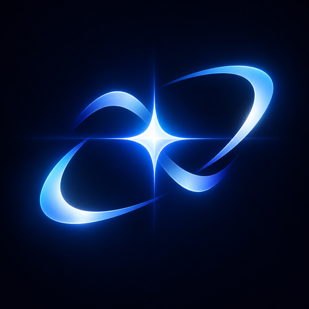

  
  <h1>NOVA Copilot for macOS</h1>
  
<strong>Your AI copilot. One shortcut away.</strong>

  
 

  
<a href="https://raw.githubusercontent.com/Ethan-cat-a/NOVA/main/NOVA-Copilot-1.3.2.dmg"><strong>↓ Download NOVA Copilot for Mac</strong></a>

---

## Built for your Mac

A native Swift / AppKit assistant that brings NOVA V8 into a lightweight floating panel. Open it from the menu bar or with **⌘ + ⇧ + Space** without losing your place.

## Features

| **Stay in your flow** | **Choose how to think** | **Keep control** |
| --- | --- | --- |
| Menu-bar access, a floating panel and animated right-edge launcher. | Fast, Hard Thinker and Coding modes. | Stop replies, keep local history and add clipboard text only when requested. |

- Streaming responses as Nova generates them.
- Recent conversations to pick up where you left off.
- Optional Launch at Login and Keep on Top.

## Install

1. [Download the Mac DMG](https://raw.githubusercontent.com/Ethan-cat-a/NOVA/main/NOVA-Copilot-1.3.2.dmg).
2. Open the DMG and drag **NOVA Copilot.app** to **Applications**.
3. Launch NOVA Copilot from Applications.

Requires **macOS 13 or later**. The universal build supports Apple silicon and Intel Macs.

> **Upgrade:** Users on 1.2.0, 1.3.0 or 1.3.1 need to install 1.3.2 manually once. Later updates can be installed from NOVA after you approve them.

> **First launch:** This build is not notarized. If macOS blocks it, Control-click **NOVA Copilot.app** in Applications, choose **Open**, then confirm **Open**. Only install apps from a source you trust.

## Privacy

- The app contains no API key; chat requests go to the existing NOVA V8 server.
- Chat history stays on your Mac.
- Clipboard text is read only when you choose the clipboard action; the app does not monitor it.

## Build from source

1. Open `NOVA Copilot.xcodeproj` in Xcode.
2. Select the **NOVA Copilot** scheme and **My Mac** as the destination.
3. Choose a signing team under **Signing & Capabilities**, then build with **⌘B** or run with **⌘R**.

Backend: `https://nova-v8.vercel.app/api/chat`

---

Looking for the Windows edition? See [NOVA Copilot for Windows](../NOVA%20Copilot%20Windows/README.md).
